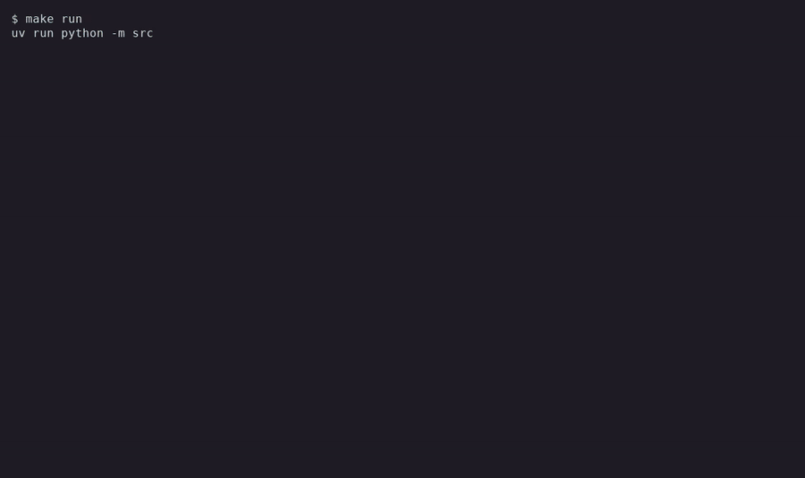

*This project has been created as part of the 42 curriculum by archowdh.*
# Call Me Maybe

## Description

**Call Me Maybe** is a project about function calling with Large Language Models (LLMs).

The goal is to build a function-calling tool that translates a natural-language user request into a structured function call.

For example, given:

```text
What is the sum of 40 and 2?
```

the program should identify the appropriate function and extract its arguments:

```json
{
    "prompt": "What is the sum of 40 and 2?",
    "name": "fn_add_numbers",
    "parameters": {
        "a": 40.0,
        "b": 2.0
    }
}
```

The main challenge is that small language models can generate unpredictable or incorrectly formatted output. Instead of asking the model to generate a complete JSON object and hoping that the result is valid, this project uses constrained decoding.

The generation process is controlled by a state machine. At every step, only tokens that are valid for the current state are allowed to be selected. Different parameter types, such as strings, integers, numbers, booleans and regular expressions, have their own rules for determining which tokens can be generated.

The project currently supports models such as:

- Qwen/Qwen2.5-0.5B-Instruct

- HuggingFaceTB/SmolLM2-1.7B-Instruct

The model can be selected from the command line.

---

## Demo

Running `make run` with the default model (`Qwen/Qwen3-0.6B`), 11 prompts. Waiting time is shortened in the video; the real run took about 3 minutes.



[▶ Watch as MP4 video](assets/demo.mp4)

---

## Instruction

The project uses Python and uv for dependency and environment management.

- Install dependencies
Create/synchronize the environment with:

```bash
uv sync
```
The project can also be installed using the Makefile:

```bash
make install
```
- Run the program

```bash
make run
```
or
```bash
uv run python -m src
```
or
```bash
uv run python -m src \
    -f data/input/functions_definition_copy.json \
    -i data/input/function_calling_tests_copy.json \
    -o data/output/function_calling_results.json
```
or # different model apart from "Qwen/Qwen2.5-0.5B-Instruct"

```bash
uv run python -m src \
    -f data/input/functions_definition.json \
    -i data/input/function_calling_tests.json \
    -o data/output/function_calling_results.json \
    -m "HuggingFaceTB/SmolLM2-1.7B-Instruct"

```
- Lint Checking

```bash
make lint
```
#strict checking
```bash
make lint-strct

```
By default, the program uses the function definitions and test prompts located in:

```text
data/input/
```

and writes the generated results to:

```text
data/output/function_calling_results.json
```
- Cleaning
To remove generated or temporary files:

```bash
make clean
```
---

## Project Goals

The implementation has four main goals:

* Select the correct function using the LLM.
* Extract the correct values from the user's natural-language prompt.
* Constrain token generation according to the expected function-call structure.
* Produce valid JSON with correctly typed parameters.

The implementation is designed to work with different function definitions and test prompts rather than hardcoding the examples provided by the subject.

---

## How It Works

The generation process can be summarized as:

```text
User Prompt
     |
     v
Load Function Definitions
     |
     v
Build LLM Prompt
     |
     v
Tokenize Input
     |
     v
Generation State Machine
     |
     v
Function Name State
     |
     v
Parameter Name State
     |
     v
Parameter Value State
     |
     +-----------------------+
     |                       |
     v                       v
More parameters         Generation Complete
     |                       |
     |                       v
     +----> Parameter   Generated Tokens
             Name State       |
                              v
                       Structured Result
                              |
                              v
                           JSON File
```

Each generated token is selected individually. At every step, the current state determines which tokens are allowed.

The model does not freely choose every possible token. The current generation state determines which tokens are allowed.

For each generation step:

1. The current state determines the valid tokens.
2. The model calculates logits for the next token.
3. Invalid tokens are ignored.
4. The highest-scoring allowed token is selected.
5. The token is added to the generated sequence.
6. The state decides whether generation should continue or transition to the next state.

This process continues until the complete function call has been generated.

---

## Algorithm explanation


1. **Load the input data**
   Read the function definitions and user prompts from the JSON input files and validate the function definitions using Pydantic.

2. **Build the LLM prompt**
   Combine the user's request with the available function definitions to tell the model which function and parameters need to be generated.

3. **Tokenize the input**
   Convert the prompt, function names, parameter names, and other required values into token IDs that the model can process.

4. **Start the state machine**
   The generation starts in `FunctionNameState`, which restricts the model to tokens that can produce one of the available function names.

5. **Generate the function name**
   At each step, the model's logits are checked and only valid tokens are allowed, preventing the model from generating an invalid function name.

6. **Generate parameter names**
   After selecting a function, `ParameterNameState` restricts generation to the parameters defined for that function.

7. **Generate parameter values**
   `ParameterValueState` uses a parameter-specific rule to generate valid values for strings, numbers, integers, and booleans.

8. **Complete the function call**
   The state machine moves between parameter states until all required parameters have been generated, then the generated tokens are converted into structured values.

9. **Create and save the result**
   The selected function and converted parameter values are assembled into a structured result and written to the output JSON file.

---

## Performance Analysis

The main performance limitation of the current implementation is the cost of token-by-token generation.

For every generated token, the program obtains the model's logits and then applies the constraints to those logits.

Conceptually, the process is:

```text
Generate token
      ↓
Run model
      ↓
Apply constraints
      ↓
Generate next token
      ↓
Run model again
      ↓
...
```

This means generation can become relatively slow, especially when a parameter value continues for many tokens.

The implementation also includes a maximum generation limit to prevent the state machine from continuing indefinitely:

```text
max_tokens = 200
```

If generation does not complete within the limit, the program raises an error and reports the state in which generation became stuck.

The complete test run processed 11 prompts in approximately **2 minutes and 33 seconds**, with individual prompts taking between 5 and 27 seconds.

---

## Design Decisions

* **State machine:** Used separate states for function names, parameter names, and parameter values to keep generation structured and predictable.
* **Constrained decoding:** Restricting allowed tokens prevents the model from generating invalid function-call structures.
* **Parameter-specific rules:** Different rules are used for strings, numbers, integers, and booleans to handle each type correctly.
* **Pydantic validation:** Used Pydantic to validate function definitions and ensure the input data has the expected structure.
* **Small LLM:** A small local model was chosen to keep the project lightweight and suitable for running without external API calls.

---

## Challenges Faced

One challenge was controlling token-by-token generation while ensuring that only valid function-call tokens were allowed.
Handling different parameter types required separate rules for strings, numbers, integers, and booleans.
Determining when a parameter value was complete and when the state machine should move to the next state was also challenging.
Another challenge was extracting the correct literal values and regex patterns from natural-language prompts, including mapping words such as “numbers” and “vowels” to the appropriate regex.

---

## Testing Strategy

The implementation was validated using 11 test prompts covering function selection and different parameter types, including strings, numbers, and regex patterns.
The generated function calls and parameter values were compared with the expected results in the test cases.
Invalid and empty input files were also tested to verify error handling and Pydantic validation.
Finally, `flake8` and `mypy` were used to check code quality, style, and type correctness.

---

## Example Usage

Run the program with the default input files and model:

```bash
make run
```

Or run it directly:

```bash
uv run python -m src
```

Custom input, output, and model paths can be provided using command-line options:

```bash
uv run python -m src \
    -f data/input/functions_definition.json \
    -i data/input/function_calling_tests.json \
    -o data/output/function_calling_results.json \
    -m "Qwen/Qwen3-0.6B"
```

The program processes each prompt, generates the corresponding function call, displays the results, and saves all results to the specified JSON output file.

After execution, the generated results can be inspected with:

```bash
cat data/output/function_calling_results.json
```

Example:

```json
[
    {
        "prompt": "What is the sum of 2 and 3?",
        "name": "fn_add_numbers",
        "parameters": {
            "a": 2.0,
            "b": 3.0
        }
    },
    {
        "prompt": "Reverse the string 'hello'",
        "name": "fn_reverse_string",
        "parameters": {
            "s": "hello"
        }
    }
]
```

---

## Bonus

### Performance Optimizations — Caching

Implemented token-text caching to avoid repeatedly decoding the same vocabulary tokens during constrained generation. This reduces unnecessary tokenizer calls and improves performance, especially when multiple parameters are processed.

### Visualization of the Generation Process

Implemented a terminal-based visualization of the generation process. It displays the current prompt, selected function, generated parameters, and execution time.

### Support for Multiple LLM Models

The implementation supports selecting different Hugging Face LLM models through the `-m` command-line option. The project was tested with models beyond the default `Qwen/Qwen3-0.6B`, demonstrating that the implementation is not tied to a single model.
Examples:
Qwen/Qwen2.5-0.5B-Instruct
HuggingFaceTB/SmolLM2-360M-Instruct
Qwen/Qwen2.5-1.5B-Instruct
HuggingFaceTB/SmolLM2-1.7B-Instruct

---

## Resources

The following resources were used to understand the technologies and concepts used in the project:

- [Pydantic Documentation](https://docs.pydantic.dev/)
- [Hugging Face Documentation](https://huggingface.co/docs)
- [Qwen Models](https://huggingface.co/Qwen)
- [Python `json` Documentation](https://docs.python.org/3/library/json.html)
- [Python `re` Documentation](https://docs.python.org/3/library/re.html)
- Regular expression references and tutorials
- Articles and documentation about constrained decoding, token generation and logits masking
- AI Usage:
     - Explaining concepts related to LLMs, tokenization, logits, state machine and constrained decoding.
     - Understanding regular expressions used in function parameters. Degugging parameter validation rules (RegEx).
     - Improving error handling and identifying edge cases.
     - Help identify and resolve typing, mypy and runtime errors.
     - Reviewing and improving the README documentation.